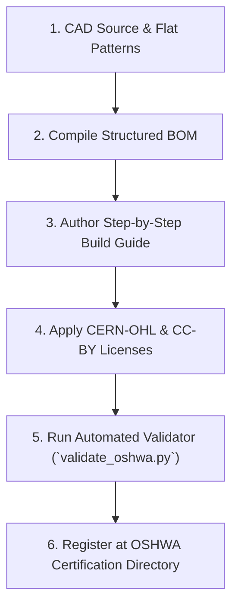

# Open-Source Hardware (OSHWA) & Maker Release Skill

This skill provides comprehensive methodologies and automated validation tooling to publish, audit, and certify physical hardware projects under the **Open Source Hardware Association (OSHWA)** criteria and open maker standards.

---

## 1. Core Principles of Open Hardware (OSHW v1.0)

For physical hardware to be truly open, accessible, and certifiable by OSHWA, makers and engineers must provide complete, unfettered access to everything required to study, modify, build, and distribute the physical artifact:

1. **Editable Source CAD**:
   - Provide original, parametric design files (e.g. FreeCAD `.FCStd`, OpenSCAD `.scad`, CadQuery / build123d `.py`, Solvespace `.slvs`, or native parametric assemblies).
   - Derivative or neutral 3D mesh files (`.stl`, `.obj`) alone are **not** sufficient source files for mechanical assemblies; solid geometry and sketches must be editable.

2. **Standard Open Interchange Formats**:
   - **3D Mechanical Assemblies**: ISO 10303 STEP AP214 / AP242 (`.step` / `.stp`) solid models for multi-CAD interoperability.
   - **2D Sheet Metal & Cutting**: Clean 2D DXF (`.dxf`) flat patterns scaled 1:1, oriented with correct cutting layers for CNC laser, plasma, and waterjet.
   - **Electronics (if present)**: Gerber RS-274X, IPC-2581, and pick-and-place XY centroid files.

3. **Complete Bill of Materials (BOM)**:
   - Must be present in machine-readable CSV format (`bom/bom.csv`).
   - Must enumerate all components, raw stock, fasteners, gaskets, and purchased modules.
   - Required fields:
     - `Part Number`
     - `Component Name`
     - `Material / Spec`
     - `Qty`
     - `Category`
     - `Vendor / Standard Reference`
     - `Estimated Unit Cost (USD)`
     - `Sourcing Notes`

4. **Self-Contained DIY Assembly Documentation**:
   - Step-by-step builder guide (`docs/assembly-guide.md`) detailing tools needed, fastener torque specs, safety warnings, and assembly sequence.
   - Designed for fabrication accessibility (e.g., self-aligning tab-and-slot joinery to eliminate proprietary jigging or expensive tooling).

5. **Dual / Tri-Licensing Framework**:
   - **Physical Hardware**: CERN Open Hardware Licence (CERN-OHL-P v2 Permissive, CERN-OHL-W v2 Weakly-reciprocal, or CERN-OHL-S v2 Strongly-reciprocal).
   - **Documentation & Media**: Creative Commons Attribution 4.0 International (`CC-BY-4.0`) or `CC-BY-SA-4.0`.
   - **Firmware / Software (if applicable)**: MIT, Apache 2.0, or GPL-3.0.

6. **Clear Attribution & Hardware Marking**:
   - Marking guidelines on physical sheet metal, PCB silkscreen, or cast components with project name, version, and open hardware logo/indicator.

---

## 2. Open Hardware Certification Workflow

Follow this procedure when preparing a hardware release:



### Step 1: Export Open Formats
Export all parametric parts into standard exchange folders:
- `cad/exports/*.step` (3D solid models)
- `cad/exports/*.dxf` (2D flat patterns for sheet metal)
Ensure bend deductions and K-factors are calibrated for target material thicknesses (e.g. 1.5mm 304 SS).

### Step 2: Assemble the BOM
Generate `bom/bom.csv` with standard part numbering prefixes:
- `PO-SM-###`: Sheet Metal parts
- `PO-ST-###`: Refractory stone & ceramics
- `PO-IN-###`: Thermal insulation
- `PO-BN-###`: Burners, regulators, and gas controls
- `PO-FS-###`: Fasteners, nuts, and rivets
- `PO-HW-###`: Hardware, handles, legs, thermometers

### Step 3: Write the Assembly Guide
Create `docs/assembly-guide.md` with:
- Required DIY hand tools
- Fastener torque specs and thermal expansion notes
- High-heat and fuel safety instructions
- First-fire burn-in / cure cycle

### Step 4: Verify Licensing
Ensure project root contains:
- `LICENSE-HARDWARE`: CERN-OHL-P v2 or CERN-OHL-S v2
- `LICENSE-DOCS`: CC-BY-4.0
- `OSHWA.md`: Compliance statement and self-certification checklist

### Step 5: Run Automated Repository Audit
Execute the validation script:
```bash
python3 .agents/skills/oshwa-hardware/scripts/validate_oshwa.py
```

---

## 3. Automated Validator Script Details

The auditor script `.agents/skills/oshwa-hardware/scripts/validate_oshwa.py` inspects:
- License integrity (`LICENSE-HARDWARE`, `LICENSE-DOCS`)
- BOM validity (CSV syntax, header compliance, non-empty part numbers, valid quantities and numeric unit costs)
- Documentation presence (`docs/assembly-guide.md`, `OSHWA.md`, `README.md`)
- CAD structure (`cad/parts/`, `cad/exports/`, `cad/assemblies/`)

Run with optional custom path:
```bash
python3 .agents/skills/oshwa-hardware/scripts/validate_oshwa.py --repo /path/to/repo
```
