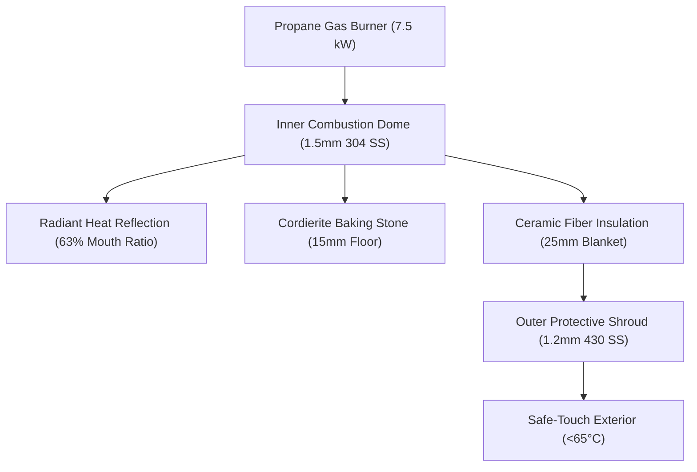

# Open Pizza Oven: Neapolitan 500

An open-source, high-performance portable pizza oven capable of reaching and sustaining **450°C–500°C (850°F–930°F)** floor and dome temperatures for authentic sub-90-second Neapolitan pizza baking. 

Engineered for **accessible DIY fabrication**: flat-pattern sheet metal with self-aligning tab-and-slot joinery, standard off-the-shelf fasteners, and zero welding required.

---

## Key Performance & Design Specifications

- **Target Temperature**: 450°C–500°C (floor & ceiling), reached in ~18–20 minutes.
- **Bake Cycle**: 60–90 seconds per 12" Neapolitan pizza.
- **Baking Surface**: 335mm x 335mm x 15mm cordierite ceramic or biscotto clay stone.
- **Burner Output**: 7.5 kW (~25,000 BTU/hr) propane burner with needle flame control and thermocouple Flame Failure Device (FFD).
- **Thermal Barrier**: 25mm high-density (128 kg/m³) bio-soluble ceramic blanket, fully encapsulated.
- **Chassis Construction**: Laser-cut 304 food-grade stainless steel (1.5mm / 2.0mm) hot chamber + 430 stainless protective shroud.
- **Exterior Safe-Touch**: Engineered air gap maintaining exterior shroud temperature <65°C under steady state.
- **DIY Cost**: Estimated ~$275 USD total build cost for a complete build including laser-cut stainless steel, cordierite stone, burner assembly, insulation, and fasteners.

---

## Engineering Architecture & Open Standards



### 1. Tab-and-Slot Zero-Weld Joinery
To make the oven truly reproducible for home makers and DIY builders, the inner dome and base plate use interlocking laser-cut tabs and slots with micro-perforated bend lines. Parts slot together and fasten securely using standard ISO M5 button-head stainless screws and serrated locknuts.

### 2. Neapolitan 63% Aperture Rule
The mouth opening height is precisely calibrated to **63% of the inner dome apex height**. This creates an optimal fluid-dynamic flame roll: fresh combustion air enters low across the front floor, while superheated exhaust rolls across the ceiling and exits out the top lip, radiating maximum heat directly down onto the pizza crust.

### 3. Open Source Hardware Association (OSHWA) Compliance
This repository adheres to the Open Source Hardware Definition (OSHW v1.0):
- **Editable Source CAD**: Available under `cad/parts/` and `cad/assemblies/`.
- **Open Interchange Formats**: ISO 10303 STEP 3D models and 1:1 DXF flat patterns under `cad/exports/`.
- **Structured BOM**: Full Bill of Materials with pricing, part numbers, and suppliers at [`bom/bom.csv`](file:///Users/adib/.gemini/antigravity/scratch/pizza-oven/bom/bom.csv).
- **Builder Documentation**: Step-by-step DIY instructions in [`docs/assembly-guide.md`](file:///Users/adib/.gemini/antigravity/scratch/pizza-oven/docs/assembly-guide.md).
- **Compliance Checklist**: Details and self-audit criteria in [`OSHWA.md`](file:///Users/adib/.gemini/antigravity/scratch/pizza-oven/OSHWA.md).

---

## Repository Structure

```
pizza-oven/
├── .agents/
│   └── skills/
│       ├── anatomy/                 # Technical isometric explainer & SVG cutaway figures
│       ├── code-cad/                # Parametric CAD models & STEP/DXF export pipeline
│       ├── material-sourcing/       # Scrap offcut discovery, local classifieds scraping & BOM pricing
│       ├── mechanical-engineering/  # Sheet metal DFM, bend allowance, thermal relief
│       ├── oshwa-hardware/          # OSHWA compliance guidelines & validation tooling
│       └── oven-thermodynamics/     # Transient heat transfer, refractory & BTU modeling
├── bom/
│   └── bom.csv                      # Complete Bill of Materials (20 components with pricing)
├── cad/
│   ├── assemblies/                  # Master assembly CAD files
│   ├── exports/                     # Ready-to-cut DXF flat patterns and STEP models
│   └── parts/                       # Parametric individual part models
├── docs/
│   ├── assembly-guide.md            # Builder's DIY step-by-step assembly guide
│   └── sourcing-report.md           # Material sourcing & local classifieds intelligence report
├── .gitignore                       # Clean ignore rules for CAD temporary files and builds
├── AGENTS.md                        # Project engineering guidelines & methodology
├── LICENSE-HARDWARE                 # CERN-OHL-P v2 (Permissive Open Hardware License)
├── LICENSE-DOCS                     # CC-BY-4.0 (Creative Commons Attribution 4.0)
├── OSHWA.md                         # Open Hardware Statement & Checklist
└── README.md                        # Project overview and guide
```

---

## Installed Skills & How to Use Them

This repository is equipped with specialized Antigravity engineering skills located in `.agents/skills/`:

| Skill | Purpose & Capabilities | How to Run / Reference |
| :--- | :--- | :--- |
| **`material-sourcing`** | Local classifieds scraping (Gumtree, Facebook), surplus offcuts, Google Shopping, B2B pricing, and automated price-drop alerts. | Run `python3 .agents/skills/material-sourcing/scripts/cli.py compare` |
| **`oshwa-hardware`** | Open hardware compliance auditing, BOM validation, and licensing verification. | Run `python3 .agents/skills/oshwa-hardware/scripts/validate_oshwa.py` |
| **`oven-thermodynamics`** | High-temp thermal balance calculations, refractory stone heat retention, gas burner BTU sizing. | See `.agents/skills/oven-thermodynamics/SKILL.md` |
| **`mechanical-engineering`** | Sheet metal K-factor calculations, thermal expansion joint gaps, GD&T, fastener schedules. | See `.agents/skills/mechanical-engineering/SKILL.md` |
| **`code-cad`** | Parametric CAD generation, tab-slot automatic alignment, STEP and DXF export pipelines. | See `.agents/skills/code-cad/SKILL.md` |
| **`anatomy`** | Interactive SVG cutaway figures, isometric exploded-view technical illustrations. | See `.agents/skills/anatomy/SKILL.md` |

---

## Quickstart: Validating the Project

To audit the repository against open-source hardware standards and verify that all CAD, BOM, licensing, and documentation requirements are satisfied:

```bash
python3 .agents/skills/oshwa-hardware/scripts/validate_oshwa.py
```

---

## Bill of Materials Overview

The total estimated cost to build the oven is **~$275 USD** for a single unit (or lower when sourcing in small batches):

- **Sheet Metal**: ~$112 (Laser-cut 304/430 stainless steel parts PO-SM-001 through PO-SM-006)
- **Refractory Baking Stone**: ~$25 (15mm cordierite ceramic or biscotto)
- **Ceramic Blanket & Gasket Insulation**: ~$25 (25mm high-temp blanket + 3mm paper gasket)
- **Burner, Gas Safety Valve & Regulator**: ~$72 (7.5 kW burner, thermocouple FFD valve, hose/regulator, and piezo igniter)
- **Fasteners, Handles & Hardware**: ~$41 (M5/M4 stainless screws, nuts, rivets, bimetal dial thermometer, and wood handle)

See [`bom/bom.csv`](file:///Users/adib/.gemini/antigravity/scratch/pizza-oven/bom/bom.csv) for full component breakdown.

---

## Licenses

- **Physical Hardware Designs**: [CERN-OHL-P v2 (Permissive)](file:///Users/adib/.gemini/antigravity/scratch/pizza-oven/LICENSE-HARDWARE)
- **Documentation & Guides**: [Creative Commons Attribution 4.0 International (CC-BY-4.0)](file:///Users/adib/.gemini/antigravity/scratch/pizza-oven/LICENSE-DOCS)
