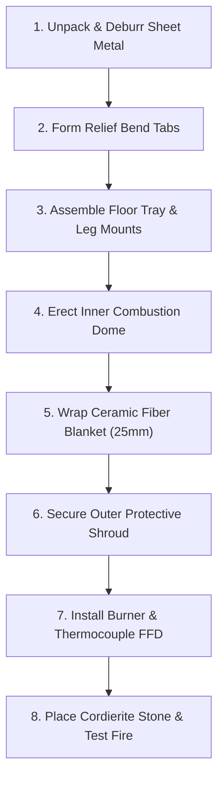

# DIY Open-Source Pizza Oven: Builder's Assembly Guide

## 1. Safety Guidelines & Prerequisites

> [!WARNING]
> **High Heat & Flammable Gas Safety**
> This oven is engineered to reach internal temperatures of **450°C to 500°C (850°F to 930°F)**.
> - **Outdoor Use Only**: Never operate indoors or inside enclosed porches/garages.
> - **Ventilation**: Keep at least 1 meter (3 feet) of clear air space around all sides of the oven.
> - **Ceramic Fiber Handling**: Always wear nitrile gloves, safety goggles, and a well-fitted P2/N95 dust mask when cutting or handling ceramic fiber insulation. The insulation is completely encapsulated between metal walls during final assembly so no loose fibers can enter the food chamber.
> - **Gas Leak Test**: Always apply soapy water to all threaded gas fittings prior to first fire. Bubbles indicate a leak.

---

## 2. Tools Required for Assembly

All mechanical connections use standard hand tools—**no welding or sheet metal brake required** when ordering pre-cut and pre-slotted parts from SendCutSend or local laser cutters.

| Tool | Specification / Usage |
| :--- | :--- |
| **4mm Hex / Allen Key** | For M5 Button Head Socket Screws |
| **8mm Open/Box Wrench** | For M5 Serrated Flange Locknuts |
| **Hand Blind Rivet Gun** | Standard hand rivet puller for M4 stainless rivets |
| **Utility Knife / Shears** | For cutting ceramic insulation blanket to size |
| **Deburring Tool / Metal File** | Softening laser cut tabs and sheet edges |
| **Work Gloves & Eye Protection** | Safety during sheet handling and insulation placement |

---

## 3. Fastener Schedule & Torque Specifications

| Fastener | Location | Recommended Torque | Notes |
| :--- | :--- | :--- | :--- |
| **M5 Button Head (A2-70)** | Inner Dome, Floor Tray, Brackets | 4.2 N·m (37 in·lb) | Do not over-torque; allow thermal expansion |
| **M5 Flange Locknut** | Inner Dome & Floor Tray | 4.2 N·m (37 in·lb) | Serrations grip sheet metal firmly |
| **M4 Stainless Blind Rivet** | Outer Shroud brackets | N/A (Shear snap) | Permanent connection on outer shell |
| **M6 Thumb Screw** | Folding Tripod Legs | Hand-tight | Quick tool-free adjustment |

---

## 4. Step-by-Step Build Instructions

### Step 1: Unpacking & Edge Deburring
1. Inspect all laser-cut parts (`PO-SM-001` through `PO-SM-006`).
2. Run a deburring tool or hand metal file around all perimeter cut edges to remove any micro-burrs left from laser piercing.
3. Peel any protective plastic PVC film off the stainless steel sheets before starting assembly.

### Step 2: Tab Forming
1. Locate the perforated bend lines on the inner dome (`PO-SM-001`) and floor tray (`PO-SM-002`).
2. Using an adjustable wrench or small hand seamer, bend each alignment tab along the laser-cut micro-slits to a 90° angle.
3. Verify that tabs seat cleanly into mating slots without binding.

### Step 3: Base Tray & Leg Assembly
1. Place the 2.0mm Base Tray (`PO-SM-002`) upside down on your work table.
2. Align the three Folding Legs (`PO-SM-006`) with their respective pivot bosses.
3. Insert M5 x 16mm button-head screws with nylon heat-resistant washers, then tighten the M5 locknut until snug while still permitting folding motion.
4. Thread in the M6 thumb screw (`PO-FS-004`) to lock each leg in the extended position.
5. Push the silicone rubber foot caps (`PO-HW-001`) onto each leg tip.

### Step 4: Inner Dome Erection
1. Turn the oven upright on its extended legs.
2. Seat the Inner Dome (`PO-SM-001`) arch over the Floor Base Tray, guiding the locating tabs into the perimeter slots.
3. Fasten the inner dome to the floor base using M5 x 12mm button-head screws (`PO-FS-001`) and serrated flange nuts (`PO-FS-002`).
4. **Thermal Expansion Note**: Leave screws finger-tight first; once all screws are seated, torque evenly to ~4 N·m.

### Step 5: Thermal Blanket Encapsulation
1. Don your dust mask, gloves, and safety glasses.
2. Unroll the 25mm bio-soluble ceramic blanket (`PO-IN-001`). Cut to 300mm x 600mm using a sharp utility knife.
3. Drape the blanket over the exterior of the inner dome, forming a snug thermal jacket.
4. Ensure the ceramic blanket does not protrude past the front mouth baffle or cover the rear burner port.

### Step 6: Outer Shroud Mounting
1. Lower the Outer Protective Shroud (`PO-SM-003`) over the insulated dome.
2. Align the bottom perimeter flange holes with the outer tray bosses.
3. Rivet the front mouth trim (`PO-SM-005`) and shroud brackets using the M4 stainless blind rivets (`PO-FS-003`) with your hand rivet tool.
4. Verify there is a consistent air gap and insulation layer between inner and outer shells.

### Step 7: Burner & Gas Safety System Installation
1. Position the high-temp ceramic paper gasket (`PO-IN-002`) over the rear burner opening.
2. Insert the U-shaped gas burner assembly (`PO-BN-001`) through the rear mount flange (`PO-SM-004`).
3. Fasten using M5 screws.
4. Mount the thermocouple probe so its tip sits directly in the pilot flame envelope (~3mm above burner ports).
5. Fasten the gas valve assembly and attach the piezo igniter lead (`PO-BN-004`).
6. Connect the propane hose and regulator (`PO-BN-003`).

### Step 8: Installing the Baking Stone
1. Slide the 15mm cordierite baking stone (`PO-ST-001`) through the front opening.
2. The stone sits directly on the built-in lower floor support rails, leaving a 5mm expansion perimeter on all sides so the stone can expand thermally without binding against the metal chassis.
3. Install the bimetal dial thermometer (`PO-HW-003`) on the side port.

---

## 5. Gas Leak Verification & Initial Curing (Burn-in)

### Leak Check:
1. Spray or brush a 50/50 mix of dish soap and water on all threaded propane fittings.
2. Turn on the propane cylinder valve (keep the oven control valve OFF).
3. Inspect for 60 seconds. **If bubbles form, turn off cylinder immediately and re-tighten the fitting.**

### Burn-in Curing Schedule:
Cordierite stones and ceramic insulation contain trace residual moisture and binder compounds from manufacturing.
1. **Low Heat (Curing Phase 1)**: Ignite burner on lowest setting (~150°C / 300°F) for 20 minutes. White vapor or faint smell is normal.
2. **Medium Heat (Curing Phase 2)**: Increase flame to medium (~300°C / 570°F) for 20 minutes.
3. **Full Neapolitan Power**: Turn to maximum. The floor stone should climb to 450°C–480°C within 15–20 minutes.
4. Allow the oven to cool down completely to ambient temperature naturally. Never splash cold water onto hot stone or stainless steel.

---

## 6. Neapolitan Baking Routine

1. **Preheat**: 20 minutes with burner on high until stone surface reaches 430°C–470°C (verify with an infrared laser thermometer).
2. **Launch**: Dust your wooden or perforated aluminum peel with semolina/flour, stretch dough, top sparingly, and slide directly onto center of stone.
3. **Flame Modulation**: Turn burner down slightly to prevent scorching top crust before base cooks through.
4. **Turn**: After 35–45 seconds, slide turning peel under pizza and rotate 180°.
5. **Finish**: Bake for another 35–45 seconds (total bake time: 70–90 seconds) until crust is puffy with authentic leopard-spotting.
